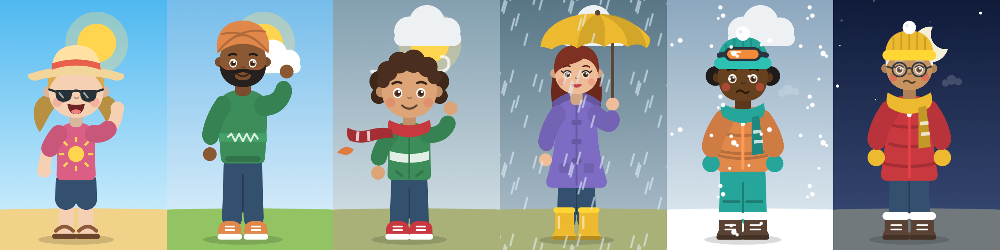
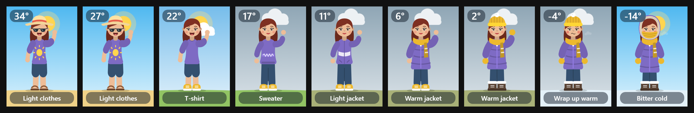
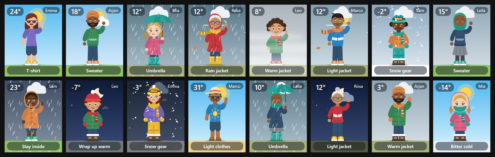
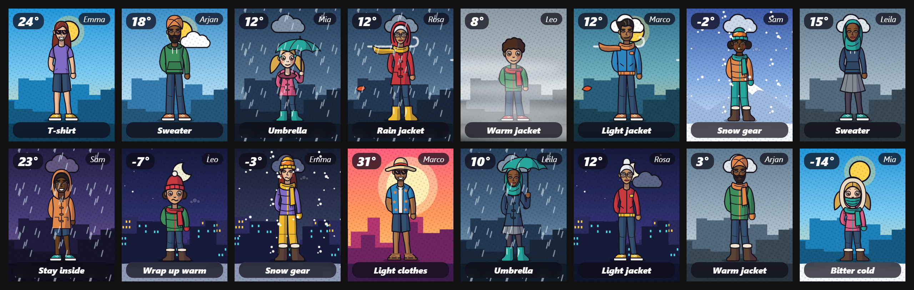
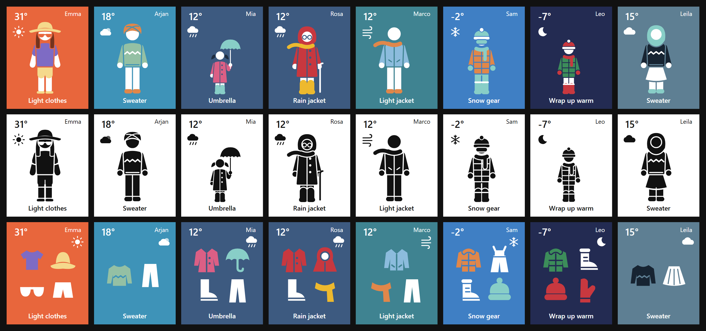

# What to Wear Card

[](LICENSE)
[](https://github.com/prusuino/ha_what_to_wear_card/releases)
[](https://github.com/prusuino/ha_what_to_wear_card/actions/workflows/validate.yml)
[](https://github.com/prusuino/ha_what_to_wear_card/actions/workflows/tests.yml)
[](https://www.home-assistant.io/)
[](https://github.com/prusuino/ha_what_to_wear_card/releases)

A dashboard card for Home Assistant that shows a person, dressed for the weather of the coming hours. One look tells you whether it takes a T-shirt, a rain jacket or a hat and gloves today.

It works with **any weather entity**, anywhere in the world.



## Highlights

- **Any weather entity**: whatever integration supplies it. No account, no key, no extra sensors.
- **Dressed for the next hours, not for this minute**: the coldest of the next three hours decides, by what the air feels like, with wind chill and humid heat.
- **Rain, snow, wind and sun**: umbrella and rubber boots, a hood instead of the umbrella when it is windy or thundering, snow trousers and goggles, scarf, gloves, sun hat and sunglasses.
- **Advice in words**: "Milder later, up to 16°", "Rain from about 14:00", "Watch out for ice".
- **Five styles**: friendly, a street comic with thick outlines and hard shadows, a pictogram as on a sign, the same in black and white (follows the light or dark theme), or only the clothes as symbols.
- **You choose the person**: four ages from child to senior, three genders, nine skin tones, twelve hairstyles, twelve hair colours, beards, glasses, freckles, earrings, cap, headscarf or turban, trousers or skirt, and the colours of the clothes.
- **One card per person**: put several side by side for a family. Someone who feels the cold gets a warmer outfit and their own advice.
- **A moving scene**: sun, stars, clouds, fog, rain, thunderstorm, snow and wind; still for anyone who turned animations off.
- **Small or large**: from a quarter of a section to a wall display, in light and dark themes.
- **Nothing is loaded from elsewhere**: the drawings are part of the card and nothing leaves your Home Assistant.
- **Set up in the editor**: no YAML needed; English, German, French and Italian, °C and °F.







## Installation

The card needs Home Assistant 2025.4 or newer.

### Home Assistant Marketplace (recommended)

1. Open **Settings → Marketplace** (Home Assistant 2026.11 or newer; on older versions open **HACS**), search for **"What to Wear"** and download it — or use the button, which opens the card directly in your Marketplace:

   [](https://my.home-assistant.io/redirect/hacs_repository/?owner=prusuino&repository=ha_what_to_wear_card&category=plugin)

2. Reload the browser.

The card is listed in the Marketplace default catalog (formerly the HACS default store), so no custom repository is needed.

### Manual

Copy `what-to-wear-card.js` from the [latest release](https://github.com/prusuino/ha_what_to_wear_card/releases/latest) to `config/www/` and add `/local/what-to-wear-card.js` as a JavaScript module under Settings → Dashboards → ⋮ → Resources, then reload the browser.

No restart is needed. Then add the card: *Edit dashboard → Add card → What to Wear*.

## Options

Everything is in the editor of the card. In YAML:

```yaml
type: custom:what-to-wear-card
entity: weather.home
name: Mia
gender: female
age: child
hair: ponytail
hair_color: blond
color: pink
```

| Option | Default | Values |
|---|---|---|
| `entity` | | a weather entity (required) |
| `style` | `friendly` | `friendly`, `comic`, `pictogram` (a person as on a sign), `mono` (black and white, follows the light or dark theme), `symbols` (only the clothes; the person does not show) |
| `name` | | shown on the card |
| `gender` | `neutral` | `female`, `male`, `neutral` |
| `age` | `adult` | `child`, `teen`, `adult`, `senior` |
| `skin` | `medium` | `porcelain`, `fair`, `light`, `medium`, `olive`, `tan`, `brown`, `deep`, `ebony` |
| `hair` | `short` | `short`, `buzz`, `curly`, `afro`, `bob`, `long`, `ponytail`, `pigtails`, `braids`, `bun`, `receding`, `bald` |
| `hair_color` | `brown` | `black`, `dark_brown`, `brown`, `light_brown`, `blond`, `platinum`, `red`, `auburn`, `grey`, `white`, `blue`, `pink` |
| `eyes` | `brown` | `brown`, `dark`, `hazel`, `green`, `blue`, `grey` |
| `beard` | `none` | `none`, `stubble`, `moustache`, `goatee`, `full` (not for children) |
| `headwear` | `none` | `none`, `cap`, `headscarf`, `turban` |
| `glasses`, `freckles`, `earrings` | `false` | |
| `color` | `teal` | the top; the colours are `teal`, `blue`, `navy`, `red`, `orange`, `yellow`, `green`, `olive_green`, `pink`, `purple`, `brown`, `beige`, `grey`, `black`, `white` |
| `bottom` | `trousers` | `trousers`, `skirt` (a skirt becomes trousers in the cold) |
| `bottom_color` | `navy` | a colour |
| `accent_color` | `yellow` | hat, scarf, gloves, umbrella, shoes |
| `feels` | `0` | degrees from −5 (feels the cold) to 5 (rarely does) |
| `hours` | `10` | 1 to 24, how far the card looks ahead |
| `show_weather`, `show_tips` | `true` | |

### Seeing what it does

`demo` shows the card with invented weather:

```yaml
type: custom:what-to-wear-card
entity: weather.home
demo:
  condition: snowy
  temperature: -2      # °C
  wind_speed: 10       # km/h
  night: false
  later: [-1, 0, 1]    # the coming hours
```

## What decides the clothes

| Feels like | Clothes |
|---|---|
| from 26 °C | T-shirt, shorts, sandals; sun hat and sunglasses in the sun |
| 20 to 26 °C | T-shirt, shorts from 22 °C |
| 14 to 20 °C | sweater |
| 8 to 14 °C | light jacket, scarf below 10 °C |
| −1 to 8 °C | warm jacket, hat below 5 °C, gloves and boots below 3 °C |
| −10 to −1 °C | the same, and a face that shows it |
| below −10 °C | fur hood, scarf over the mouth |

- **What it feels like** is the weather entity's own value for the hours that have one, otherwise it is calculated: wind chill up to 10 °C, the heat index from 27 °C and 40 % humidity.
- **Rain** counts when the condition says so, or from 0.3 mm in an hour with a chance of at least 40 %. Between 8 and 20 °C it takes a raincoat and rubber boots. From 30 km/h of wind (gusts of 50) or in a thunderstorm the hood replaces the umbrella.
- **Snow** takes snow trousers, boots, a hat and gloves.
- The card uses the **hourly** forecast when the entity has one, otherwise the twice-daily or daily one, which says less about the next hours.
- It is a drawing, not a safety advice: in severe weather, follow the official warnings.

## Disclaimer

Provided **as-is, without any warranty**. The card gives a hint from a weather forecast, and forecasts can be wrong. It is not a safety advice: in severe weather, follow the official warnings.

## License

MIT – see [LICENSE](LICENSE). The drawings were made for this card and are covered by the same license.

## Related projects

More of my Home Assistant projects are in [my GitHub profile](https://github.com/prusuino?tab=repositories).

## Support

<a href="https://www.buymeacoffee.com/prusuino"></a>
